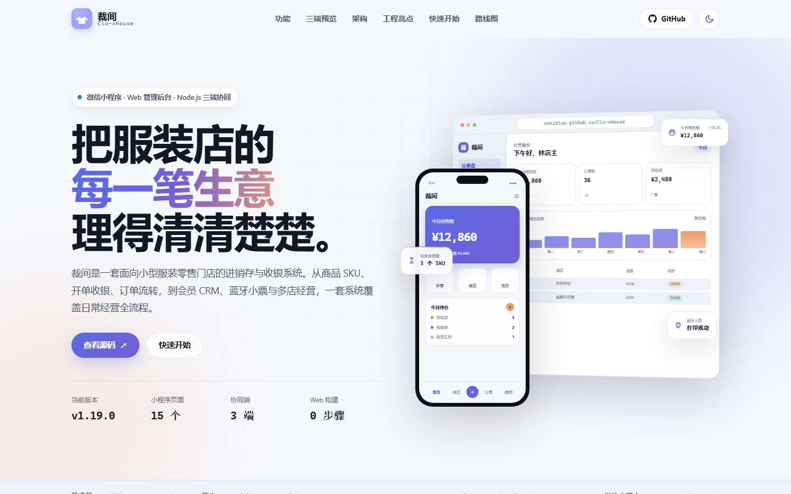
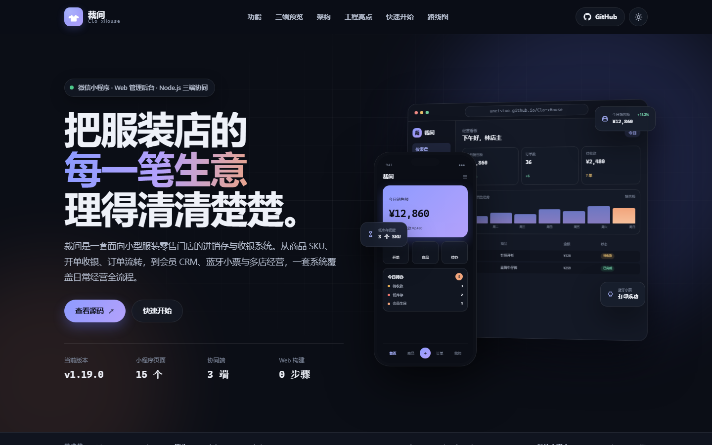
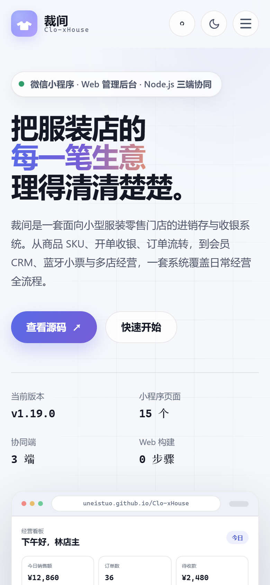
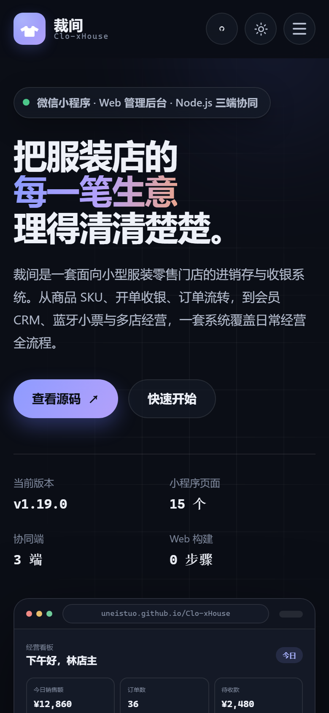
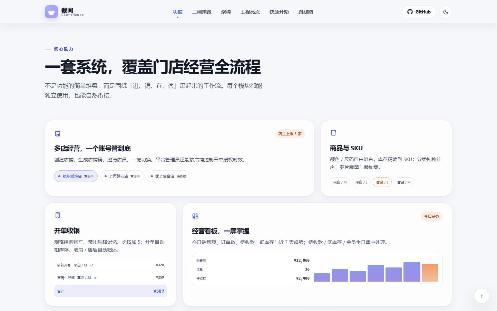

# Clothing Store Management System

English | [简体中文](README.md)

An inventory, checkout and store-management system for small clothing retailers. It consists of a **WeChat Mini Program client**, a **Web admin console** and a **Node.js backend**.

> Live showcase: <https://uneistuo.github.io/Clo-xHouse/>

## Preview

<p align="center">
  
  
</p>
<p align="center">
  
  
</p>



## Features

### Mini Program

- **Accounts**: self-service registration and login, JWT session persistence.
- **Stores**: create stores (up to 3 per owner), join with a store code, switch between stores, manage members, reset store codes.
- **Products**: search, publish / unpublish, colour and size SKU combinations, stock management, drag-and-drop category sorting.
- **Checkout**: spec-group cart, stock deduction inside a transaction, order flow (pending payment → paid → completed), automatic stock return on cancellation / after-sales.
- **Dashboard**: today's revenue, order count, pending payments, products on sale, recent receipts and today's to-dos (pending payments / low stock / member birthdays, opened from the top-right entry and handled in a centred modal).
- **Bluetooth printing**: pair, connect and test ESC/POS receipt printers, reprint receipts, built-in UTF-8 → GBK table for Chinese text.
- **Platform admin**: control the checkout authorisation window of each store through a whitelist.

### Project Showcase (GitHub Pages)

`web/` is now a project introduction page: hero product preview, feature bento, three-client preview, architecture, engineering highlights, quick start and release roadmap. It is fully static, zero-build, and supports light / dark themes and PWA installation. The original Web admin console is archived in `archive/web-admin-v1.19.0/`.

### Backend

- Express + MySQL (mysql2 connection pool), bcrypt password hashing, JWT authentication.
- Three-level middleware guards: authentication → store binding (`requireStore`) → platform permission (`requirePlatform`).
- Image uploads: multer (5 MB limit, JPG / PNG / WebP); optionally Tencent Cloud COS, otherwise local disk.
- Automatic schema migration (`schema.sql`) and idempotent index creation.
- Security and observability: login / registration rate limits, CORS allowlist, sanitised errors, pino structured logs, enhanced health check, graceful shutdown.
- API docs: Swagger UI (`/api-docs`); integration tests: jest + supertest (`npm test`).

## Roles

| Role           | Permissions                                                      |
| -------------- | ---------------------------------------------------------------- |
| Platform admin | View all stores, set the checkout authorisation window per store |
| Store owner    | Create / manage multiple stores, store codes, members            |
| Store employee | Join a store with a store code, create orders and take payments  |

## Directory Structure

```
├── app.js / app.json / app.wxss    # Mini Program entry and global config
├── pages/                          # Mini Program pages
│   ├── index/                      # Dashboard
│   ├── login/                      # Login / registration
│   ├── store/                      # Store management (multi-store switch)
│   ├── goods/ goods-edit/ category/# Products and categories
│   ├── billing/                    # Checkout
│   ├── orders/ order-detail/       # Order list and detail
│   ├── printer-pair/               # Bluetooth printer pairing
│   └── platform/                   # Platform admin (checkout authorisation)
├── utils/                          # Utilities (core modules migrated to TypeScript)
│   ├── api.ts                      # Request wrapper (token / 401 / retry)
│   ├── util.ts                     # Money formatting, status labels, etc.
│   ├── dialog.ts                   # Promise-based dialogs and toasts
│   ├── escpos.js gbk.js printer.js receipt.js   # ESC/POS Bluetooth printing
│   └── theme.js                    # Theme switching
├── components/navigation-bar/      # Custom navigation bar component
├── web/                            # Project showcase (static single page, zero-build)
│   ├── index.html                  # Showcase entry (hero / features / previews / architecture / roadmap)
│   ├── manifest.json sw.js         # PWA manifest and service worker
│   ├── js/main.js                  # Theme, navigation, tabs, scroll reveal and copy
│   ├── styles/                     # Five layers: tokens/base/layout/components/animations
│   └── assets/                     # PWA icons and favicon
├── archive/web-admin-v1.19.0/      # Full backup of the original Web admin console (not deployed)
├── styles/icons.source.json        # Shared icon source for Web and Mini Program
├── scripts/build-icons.js          # Icon generation / validation
├── scripts/build-pwa-icons.js      # PWA icon generation
├── backend/                        # Node.js backend
│   ├── server.js config.js db.js   # Server entry / config / database
│   ├── swagger.js                  # Swagger / OpenAPI docs (/api-docs)
│   ├── schema.sql                  # MySQL schema
│   ├── routes/                     # Business routes (auth/store/goods/orders/...)
│   ├── middleware/                 # Auth and permission guards
│   ├── utils/logger.js             # pino structured logging
│   ├── test/                       # jest + supertest integration tests
│   └── Dockerfile                  # Cloud hosting image
├── docs/optimization-plan.md       # Optimisation plan and progress
├── docs/screenshots/               # README screenshots (desktop / mobile, light / dark)
└── .github/workflows/              # CI/CD workflows
```

> Note: `.json` config files cannot contain comments because of the format. Each file's purpose is documented in the header comment of its sibling `.js` / `.wxml` file.

## Quick Start

### Backend (local development)

```bash
cd backend
npm install            # or double-click install.bat on Windows
npm run start:dev      # development mode (or start.bat; logs go to server.log)
npm test               # jest + supertest integration tests (no real MySQL required)
```

MySQL is required. Connection settings come from environment variables (see `backend/config.js`); the schema is created automatically on first start.

| Variable                                                                         | Description                                                                                                                 |
| -------------------------------------------------------------------------------- | --------------------------------------------------------------------------------------------------------------------------- |
| `JWT_SECRET`                                                                     | JWT secret. **Required in production** (the server refuses to start without it); optional in dev.                           |
| `MYSQL_ADDRESS` / `MYSQL_USERNAME` / `MYSQL_PASSWORD`                            | MySQL connection values injected by cloud hosting.                                                                          |
| `MYSQL_HOST` / `MYSQL_PORT` / `MYSQL_USER` / `MYSQL_PASSWORD` / `MYSQL_DATABASE` | Local development overrides.                                                                                                |
| `CORS_ORIGIN`                                                                    | Browser origin allowlist (comma-separated). Defaults to `https://uneistuo.github.io`; Mini Program requests are unaffected. |
| `RATE_LIMIT_WINDOW_MS` / `RATE_LIMIT_MAX`                                        | Login / registration rate limit (default: 10 requests per 15 minutes).                                                      |
| `LOG_LEVEL`                                                                      | Log level (default `info`; production emits structured JSON).                                                               |
| `ENABLE_API_DOCS`                                                                | Set to `false` to disable the `/api-docs` online API reference.                                                             |
| `UPLOAD_MAX_BYTES` / `REQUEST_TIMEOUT_MS`                                        | Upload size limit (default 5 MB) / request timeout (default 60 s).                                                          |

API docs: `http://127.0.0.1:3000/api-docs` after startup (raw OpenAPI spec at `/api-docs.json`).
Health check: `GET /api/health` returns database status, memory usage, version and uptime.

### Backend (Docker / WeChat Cloud Hosting)

`backend/Dockerfile` is based on `node:22-alpine`. Pushing to `master` triggers a GitHub Actions image build for validation.
**Before deploying, set `JWT_SECRET` in the cloud hosting service's environment variables** (a long random string; generate one with
`node -e "console.log(require('crypto').randomBytes(48).toString('hex'))"`), otherwise the service refuses to start.

### Mini Program

Import the project root into WeChat DevTools. `utils/api.ts` automatically switches between local and cloud-hosted endpoints.
Core utility modules (`utils/api`, `utils/util`, `utils/dialog`) are written in TypeScript and compiled by DevTools through
`useCompilerPlugins: ["typescript"]` in `project.config.json`. Type-check locally with `npm install && npm run typecheck` in the repository root.

### Code quality (repository root)

```bash
npm run lint           # ESLint for Mini Program JavaScript
npm run format         # Prettier for TS / JSON / Markdown and more
```

Husky + lint-staged run ESLint / Prettier on staged files before each commit; commits with formatting errors are rejected.

### Project showcase

Changes under `web/` are deployed to GitHub Pages automatically by GitHub Actions; no manual deployment is needed.

- **Content**: hero product preview, feature bento, three-client preview, architecture, engineering highlights, quick start, release roadmap and FAQ.
- **Zero-build**: native HTML / CSS / ES Modules, no bundler or framework. Preview it with any static file server.
- **Themes and motion**: light / dark themes follow the system and are remembered; scroll reveal, tab switching and code copy all respect `prefers-reduced-motion`.
- **PWA**: `manifest.json` + `sw.js` (cache version `cj-site-v1`), installable, network-first for navigation and static assets with an offline cache fallback.
- **Archive**: the original Web admin console is preserved in `archive/web-admin-v1.19.0/`; see its `README.md` for restore instructions. The archive directory is never published to GitHub Pages.

## CI / CD Workflows

| Workflow                          | Trigger                        | Purpose                                               |
| --------------------------------- | ------------------------------ | ----------------------------------------------------- |
| `deploy-web.yml`                  | push touching `web/**`, manual | Publish the project showcase to GitHub Pages          |
| `docker-image.yml`                | push to master / pull request  | Build the backend Docker image for validation         |
| `npm-publish-github-packages.yml` | release created                | Test, then publish the npm package to GitHub Packages |

## Version History

| Version | Summary                                                                                                                                                                                                                                                                                                                                                                                                                                                                                                                                                                                                                                                                                                                                                                                                                                                                                                                            |
| ------- | ---------------------------------------------------------------------------------------------------------------------------------------------------------------------------------------------------------------------------------------------------------------------------------------------------------------------------------------------------------------------------------------------------------------------------------------------------------------------------------------------------------------------------------------------------------------------------------------------------------------------------------------------------------------------------------------------------------------------------------------------------------------------------------------------------------------------------------------------------------------------------------------------------------------------------------- |
| v1.11   | Bluetooth receipt printing and multi-store support for owners.                                                                                                                                                                                                                                                                                                                                                                                                                                                                                                                                                                                                                                                                                                                                                                                                                                                                     |
| v1.12   | Web admin console (deployed to GitHub Pages), platform admin page, permission-probe fallback.                                                                                                                                                                                                                                                                                                                                                                                                                                                                                                                                                                                                                                                                                                                                                                                                                                      |
| v1.13   | Site-wide UI/UX pass (design tokens, vector icons, custom TabBar), cart persistence, success card, low-stock warnings, bulk publish / delete, order status tabs + date filters, 7-day sales trend, remembered login account, matching Web improvements, backend support (SKU search, dashboard periods / trends / low stock).                                                                                                                                                                                                                                                                                                                                                                                                                                                                                                                                                                                                      |
| v1.14.0 | Simplified home page (removed quick entries and today's receipts; revenue and order count share one row); unified navigation title to "裁间"; moved the category entry to a leading hamburger icon without a background; custom TabBar background fallback and unified press feedback on all five tabs; member modal gender picker changed to segmented pills, surname and gender on one row; lighter, non-bold empty-state copy.                                                                                                                                                                                                                                                                                                                                                                                                                                                                                                  |
| v1.14.1 | P0–P3 improvements: security hardening (mandatory JWT secret, login rate limit, CORS allowlist, upload validation, sanitised errors); performance (batch SKU queries, unique order numbers, checkout pagination + search, lazy image placeholders); observability and stability (structured logs, health check, automatic index migration, graceful shutdown); engineering (TypeScript migration, Jest tests and coverage, Swagger docs, Prettier + husky hooks).                                                                                                                                                                                                                                                                                                                                                                                                                                                                  |
| v1.15.0 | Registration and binding flow rebuilt: login page reduced to pure login; new standalone "register + bind" page (three steps with progress line); new welcome page (brand, success animation, feature tour); unified unbound fallback (home / profile / API 1001 / login success) pointing to the bind page; retired `pages/setup`; no backend changes.                                                                                                                                                                                                                                                                                                                                                                                                                                                                                                                                                                             |
| v1.15.1 | Site-wide glassmorphism × soft-UI redesign: three-layer background glow, five glass elevation levels, unified radii / shadows / motion, rebuilt TabBar and sheets, accessibility fallbacks; checkout settlement bar changed from fixed to scrolling with content; removed the "paid on the spot" card so new orders are always pending payment.                                                                                                                                                                                                                                                                                                                                                                                                                                                                                                                                                                                    |
| v1.16.0 | P0–P3 UI/interaction fixes: dashboard bookmark colours and concave transitions; store card drag handle to expand / collapse with measured collapsed height, scroll lock while dragging, empty-member fallback; checkout settlement bar fixed and merged with the custom TabBar, full pill retained without checkout permission; safe-area and accessibility fallbacks.                                                                                                                                                                                                                                                                                                                                                                                                                                                                                                                                                             |
| v1.17.0 | P0–P3 UI/UX delivery: order status timeline (backend timestamps + detail page timeline / pulse); product image cropping (`wx.editImage`, preview, set cover); home quick checkout / photo upload, today's to-dos, year-over-year comparison and staggered fade-in; checkout spec picker (recent specs, dashed orange low-stock border, long-press +5); member CRM (level badge, tags, birthday reminder, quick note); print settings (three templates + 58/80 mm, last 10 print records, offline hint); grouped Web sidebar navigation; additional vector icons and on-demand glow rendering; product image drag sorting, reusable `skeleton-card`, new `star/crown/gem/gift/layout/document` icons, preset popular products for quick checkout.                                                                                                                                                                                   |
| v1.17.1 | UI-spec audit fixes and first-frame stabilisation: home information hierarchy reordered (revenue card → quick checkout / product upload → today's to-dos → combined "product overview + 7-day sales" card → low stock), removed standalone pending-payment / period-order cards; custom TabBar generalised from `billingDock` to `dock` (shared by checkout settlement and product bulk bar); `attached` derives selected / merged state on the first frame and skips morph animation, no `setData` when state is unchanged, eliminating page-entry jumps and repaints; checkout page renders the first frame from the store authorisation cache, updates fields incrementally, skips cart refill when unchanged, refreshes silently on re-entry and uses `skeleton-card`; global navigation / window background tweaks (`app.json`); spacing unified to multiples of 4, radii and font sizes use tokens per `UI-AUDIT-REPORT.md`. |
| v1.17.2 | Request pipeline rebuilt (cloud-hosted default domain is test-only and not allowed in production): business requests go through `wx.cloud.callContainer` (Cloud Development → Cloud Hosting, no domain allowlist or ICP filing needed; falls back to `wx.request` without Cloud Development); retries use exponential backoff 1.5/3/6/10 s for cold starts, with `errMsg` in failure messages; product image upload compresses to base64 and posts to `POST /api/upload/base64` (new endpoint, JSON body limit 1 MB → 8 MB, reuses COS), also visible in the Web console; falls back to direct Cloud Development storage upload when the backend is unavailable; `resolveImg` supports `cloud://` file IDs; deployment fixes: Alpine mirrors switched to Tencent and `tzdata` failures no longer block the build; `nowStr()` computes UTC+8 explicitly without relying on container timezone / tzdata.                             |
| v1.18.0 | Performance and documentation overhaul: Web admin split into 16 native ES Modules (`web/js/`, zero-build) + 7 CSS layers, `bus.js` breaks the store → shell cycle; checkout uses `pageSize=30` pagination + load more and `loading="lazy"` images, pagination resets after checkout; breadcrumbs, keyboard shortcuts, error boundary, receipt printing, PWA (SW v5 / 32 precached assets), dark mode and collapsible sidebar; Mini Program cart quantities use `setData` path updates, ARIA added to all 15 pages, compressed image uploads; `scripts/build-icons.js` generates and validates Web / Mini Program icons; design specs, optimisation plan and two review reports added; `lint:web` / `format:check` wired into CI.                                                                                                                                                                                                   |
| v1.19.0 | Today's to-dos rebuilt: home top-right reduced to a circular icon entry, to-dos moved into a centred modal (single-line items, fixed-width count pills aligned right, empty state matching global rules); checkout success glow animation (Mini Program recreates `transfer-glow` in WXSS: breathing halo + three-colour rising particles + icon pop-in; Web gains a `successGlow` component replacing the toast) and theme-toggle icon rotation; spec alignment (modal spacing all multiples of 4, font sizes all tokens, product page FAB copy removed); fixed `wx.getSystemInfoSync` deprecation warnings (switched to `getDeviceInfo` / `getWindowInfo`) and invalid component WXSS tag-selector warnings (`custom-tab-bar` / `custom-confirm` now declare variables with `:host`).                                                                                                                                            |
